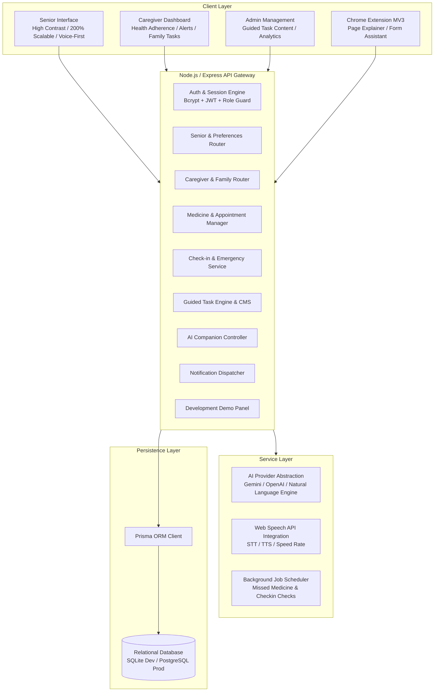

# ElderEase — System Architecture Plan

## 1. Executive Summary
**ElderEase** ("An AI Companion for Safe and Independent Digital Living") is an accessible, human-centered assistive platform tailored for senior citizens. It bridges the digital divide through simplified interfaces, multilingual conversational AI (Marathi, Hindi, English, Hinglish), proactive health reminders, transparent family caregiver loops, and safe browsing assistance.



---

## 2. Monorepo Folder Structure

```
PBL-Project/
├── server/                    # Node.js + Express + TypeScript Backend
│   ├── src/
│   │   ├── config/            # Env configuration and secrets
│   │   ├── controllers/       # Route controllers (auth, senior, caregiver, medicines, etc.)
│   │   ├── middleware/        # JWT auth, role validation, error handling, rate limits
│   │   ├── routes/            # REST API route declarations
│   │   ├── services/          # AI Service abstraction, notification engine, scheduler
│   │   ├── utils/             # Audit logger, encryption, helpers
│   │   └── index.ts           # Server entry point
│   ├── prisma/
│   │   ├── schema.prisma      # Complete relational schema (22 models)
│   │   └── seed.ts            # Realistic seed data (Demo Aai, Demo Daughter, tasks)
│   ├── package.json
│   └── tsconfig.json
│
├── client/                    # React 18 + TypeScript + Vite Frontend
│   ├── public/                # Static assets, audio chimes, icons
│   ├── src/
│   │   ├── assets/            # SVG icons, illustrations
│   │   ├── components/        # Accessible components
│   │   │   ├── common/        # BigButton, SpeechWave, Card, Modal, NotificationBell
│   │   │   ├── senior/        # SeniorHome, MedicineCard, EmergencyModal, CheckinModal, TaskRunner
│   │   │   ├── caregiver/     # StatusOverview, MedicineManager, AppointmentManager, FamilyTasks
│   │   │   ├── ai/            # CompanionChatModal, VoiceMicrophone, ScamSafetyChecker
│   │   │   ├── tasks/         # GuidedTaskLibrary, StepViewer, SessionRecovery
│   │   │   └── admin/         # TaskEditor, AnalyticsDashboard, DemoControls
│   │   ├── context/           # AuthContext, PreferencesContext, NotificationContext, LanguageContext
│   │   ├── hooks/             # useSpeechRecognition, useSpeechSynthesis, useApi
│   │   ├── services/          # API client with Axios / Fetch
│   │   ├── styles/            # Design tokens, variables, high-contrast themes, typography
│   │   ├── translations/      # Marathi (mr), Hindi (hi), English (en) dictionaries
│   │   ├── App.tsx            # Routes, layout wrappers, accessibility root
│   │   └── main.tsx           # Entry point
│   ├── index.html
│   ├── package.json
│   ├── tsconfig.json
│   └── vite.config.ts
│
├── extension/                 # Chrome Manifest V3 Browser Extension
│   ├── manifest.json          # MV3 configuration with activeTab & scripting
│   ├── src/
│   │   ├── popup.html         # Senior-friendly clean extension popup
│   │   ├── popup.ts           # Extension logic: Talk to ElderEase, Explain Page
│   │   ├── popup.css          # High-contrast accessible popup styling
│   │   ├── background.ts      # Service worker for backend communication
│   │   └── content.ts         # Safe DOM visible-text extractor & element highlighter
│   ├── icons/                 # Extension icons (16, 48, 128)
│   └── package.json
│
├── docs/                      # Architectural, setup, and specification documentation
│   ├── IMPLEMENTATION_STATUS.md
│   ├── ARCHITECTURE.md
│   ├── SETUP.md
│   ├── API.md
│   ├── DATABASE.md
│   ├── EXTENSION.md
│   ├── SECURITY.md
│   ├── TESTING.md
│   └── DEMO.md
└── README.md
```

---

## 3. Core Subsystems

### 3.1 Senior Experience Design
- **Typography & Accessibility**: Base 20px font, scalable up to 200% (40px) without breaking layout. High contrast (WCAG AAA 7:1 ratio available). Large touch targets (minimum 56px height for primary actions).
- **Navigation**: Shallow 2-tier hierarchy. Big persistent actions: Talk to ElderEase, Medicines, Appointments, I Am Okay, I Need Help, Call Family.
- **Multilingual Support**: Instant toggle between Marathi (मराठी), Hindi (हिंदी), and English (English), with colloquial Hinglish and Marathi conversational comprehension in AI.

### 3.2 AI Companion Subsystem
- **Provider-Agnostic Abstraction**:
  - `AiService` interface with `chat()`, `explainPage()`, `analyzeMessageSafety()`, `extractPrescription()`.
  - Built-in intelligent rule & context engine for offline/fallback mode (ensures 100% test reliability with zero external dependencies).
  - External LLM adapter (Gemini API / OpenAI) enabled when `AI_API_KEY` is provided.
- **Voice System**:
  - Native Web Speech API STT with language codes `mr-IN`, `hi-IN`, `en-IN`.
  - Speech Synthesis with slow (0.8x) and normal (1.0x) speeds, respectful tone, and reassurance phrases ("Kahi harakat nahi. Punha ekda karuya").

### 3.3 Caregiver & Safety Subsystem
- **Invitation & Pairing**: Caregiver enters a secure 6-character connection code generated by the senior; senior explicitly approves connection.
- **Real-Time Notification Pipeline**: Immediate alerts for missed medicines, missed check-ins, help requests, and suspicious messages.
- **Emergency Dispatch**: Confirmed intent triggers immediate caregiver notification with optional coordinates, audio chime, and phone link.

### 3.4 Browser Extension
- **Safe Web Page Assistance**: Explicit user activation only. Content script extracts visible non-sensitive text and requests step-by-step guidance from the ElderEase API.
- **Safety Boundary**: The extension strictly blocks automated filling of passwords, OTPs, CVVs, and banking PINs.
