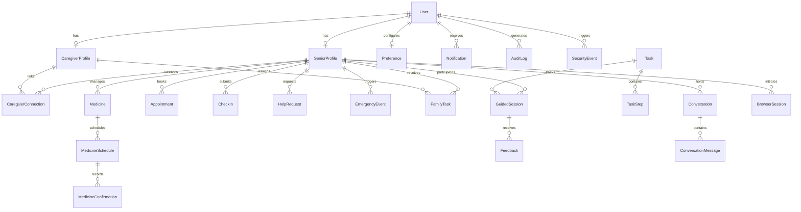

# ElderEase Database Specification

The ElderEase database design utilizes a normalized relational model managed through Prisma ORM.

## Entity-Relationship Overview

## Detailed Entities

1. **User**: `id`, `name`, `email`, `phone`, `passwordHash`, `role` (SENIOR, CAREGIVER, ADMIN), `createdAt`, `updatedAt`
2. **SeniorProfile**: `id`, `userId`, `emergencyContactName`, `emergencyContactPhone`, `inviteCode`, `birthYear`, `medicalNotes`
3. **CaregiverProfile**: `id`, `userId`, `relationshipToSenior`, `alertPreferences`
4. **CaregiverConnection**: `id`, `seniorId`, `caregiverId`, `status` (PENDING, APPROVED, REVOKED), `permissions`, `createdAt`
5. **Preference**: `id`, `userId`, `language` ('en', 'hi', 'mr'), `fontSize` ('NORMAL', 'LARGE', 'EXTRA_LARGE'), `voiceSpeed` ('SLOW', 'NORMAL'), `highContrast` (boolean), `ttsEnabled` (boolean)
6. **Task**: `id`, `title`, `description`, `category`, `difficulty`, `isPublished`, `icon`, `createdAt`
7. **TaskStep**: `id`, `taskId`, `stepNumber`, `title`, `instructionEn`, `instructionHi`, `instructionMr`, `expectedAction`, `mediaUrl`
8. **GuidedSession**: `id`, `seniorId`, `taskId`, `currentStepIndex`, `status` (IN_PROGRESS, COMPLETED, ABANDONED), `lastActiveAt`
9. **Medicine**: `id`, `seniorId`, `name`, `dosage`, `instructions`, `startDate`, `endDate`, `active`
10. **MedicineSchedule**: `id`, `medicineId`, `time` (HH:MM), `frequency` ('DAILY', 'WEEKLY'), `daysOfWeek`
11. **MedicineConfirmation**: `id`, `scheduleId`, `scheduledFor` (DateTime), `status` ('TAKEN', 'DELAYED', 'MISSED'), `confirmedAt`, `notes`
12. **Appointment**: `id`, `seniorId`, `doctorName`, `specialty`, `dateTime`, `location`, `reminderMinutesBefore`, `notes`, `status`
13. **CheckIn**: `id`, `seniorId`, `date` (YYYY-MM-DD), `status` ('OKAY', 'HELP_NEEDED', 'MISSED'), `respondedAt`, `notes`
14. **HelpRequest**: `id`, `seniorId`, `type` ('FAMILY_CALL', 'GENERAL_ASSISTANCE'), `status` ('OPEN', 'ACKNOWLEDGED', 'RESOLVED'), `message`, `createdAt`
15. **EmergencyEvent**: `id`, `seniorId`, `latitude`, `longitude`, `resolved`, `audioAlertPlayed`, `createdAt`
16. **Notification**: `id`, `recipientId`, `title`, `message`, `type` ('MISSED_MEDICINE', 'CHECK_IN', 'HELP_REQUEST', 'EMERGENCY', 'APPOINTMENT', 'SYSTEM'), `isRead`, `entityId`, `createdAt`
17. **FamilyTask**: `id`, `seniorId`, `caregiverId`, `title`, `description`, `dueDate`, `isCompleted`, `createdAt`
18. **Feedback**: `id`, `sessionId`, `rating` ('GOOD', 'POOR'), `comment`, `createdAt`
19. **Conversation**: `id`, `seniorId`, `title`, `createdAt`
20. **ConversationMessage**: `id`, `conversationId`, `sender` ('SENIOR', 'AI'), `content`, `audioPlayed`, `createdAt`
21. **BrowserSession**: `id`, `seniorId`, `domain`, `pageTitle`, `helpRequested`, `summaryGenerated`, `createdAt`
22. **SecurityEvent**: `id`, `userId`, `eventType` ('SCAM_CHECK', 'PAYMENT_WARNING', 'SENSITIVE_INPUT_BLOCKED'), `details`, `createdAt`
23. **AuditLog**: `id`, `userId`, `action`, `resource`, `ipAddress`, `createdAt`
