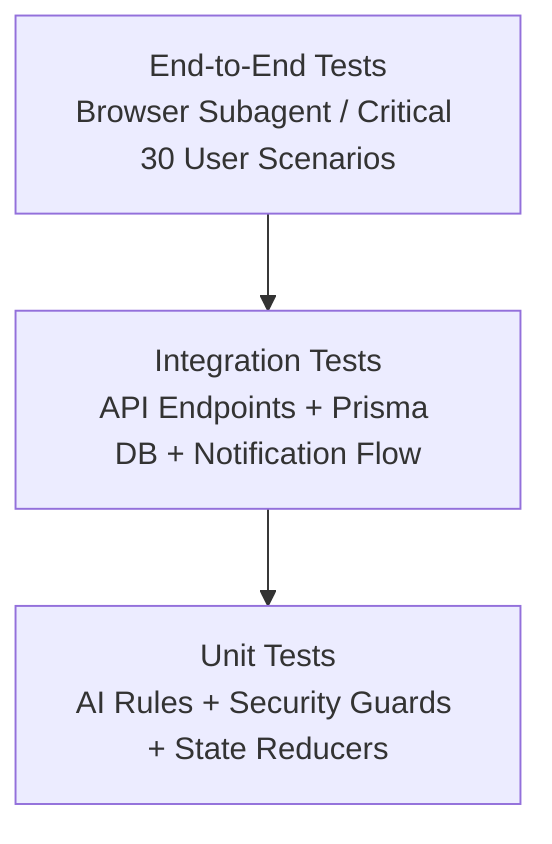

# ElderEase Testing Strategy & Verification Plan

This document outlines the testing regime covering automated unit tests, integration tests, and manual/browser end-to-end verification.

## 1. Test Layers

## 2. 30 Critical End-to-End Scenarios Matrix

| Test # | Scenario Description | Expected Outcome | Verification Method |
| :---: | :--- | :--- | :--- |
| **TEST 1** | Senior registration | Account created with preferences | Automated API / Form |
| **TEST 2** | Senior login | Returns JWT and senior profile | API / Auth state |
| **TEST 3** | Language switch | UI texts update across screens | UI re-render |
| **TEST 4** | Font size zoom | Font scales to Large / 200% | CSS compute |
| **TEST 5** | Talk to AI | Senior query parsed and answered | AI Chat response |
| **TEST 6** | AI Voice response | Web Speech TTS triggers with audio | SpeechSynthesis Mock/Live |
| **TEST 7** | Create medicine reminder | Stored with schedule times | Database query |
| **TEST 8** | Reminder alert triggers | Reminder prompt displays with [Taken]/[Delay] | UI verification |
| **TEST 9** | Confirm medicine taken | Confirmation logged in DB | DB state verified |
| **TEST 10**| Caregiver sees taken dose | Caregiver dashboard reflects taken dose | Caregiver API / View |
| **TEST 11**| Senior skips/misses dose | Dosing window expires | Cron job simulation |
| **TEST 12**| Caregiver missed medicine alert| Missed dose notification generated | Notification table |
| **TEST 13**| Daily check-in performed | "I Am Okay" logged for today | CheckIn record verified |
| **TEST 14**| Caregiver sees check-in | Status displays "Morning check: Completed" | Caregiver screen |
| **TEST 15**| "I NEED HELP" clicked | Confirmation modal requires intent | Safety modal |
| **TEST 16**| Emergency alert generated | Caregiver notified with urgent banner | Notifications query |
| **TEST 17**| Create doctor appointment | Stored with date, time, location | Appointments query |
| **TEST 18**| Appointment reminder | Reminder appears before appointment | Alert triggers |
| **TEST 19**| Ask AI about appointments | AI answers with upcoming doctor visit | AI context check |
| **TEST 20**| Senior generates invite code | Caregiver connects using invite code | Pairing approved |
| **TEST 21**| Unauthorized caregiver access| Caregiver blocked from unlinked senior | 403 Forbidden verified |
| **TEST 22**| Extension loaded | Manifest V3 validates and loads | Chrome unpack check |
| **TEST 23**| Extension auth connection | Extension pairs with user session | Storage token check |
| **TEST 24**| Extension reads page text | Visible text extracted without passwords | Script injection check |
| **TEST 25**| Extension step guidance | Displays step 1 of web navigation | UI step card |
| **TEST 26**| Safe payment environment | Mock UPI prompts for amount confirmation | Mock UPI safety flow |
| **TEST 27**| Scam detection query | Cautious analysis warning about OTP scam | AI scam response |
| **TEST 28**| Cautious safety explanation | Non-definitive reassuring language | NLP rule check |
| **TEST 29**| Sensitive action confirmation | Confirmation dialog before any major action | Guard trigger |
| **TEST 30**| Server error resilience | Friendly message shown, no raw 500 error | Error boundary |
